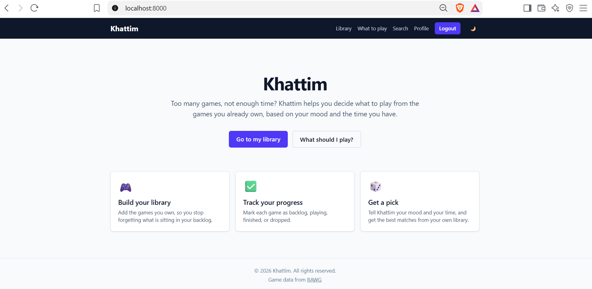
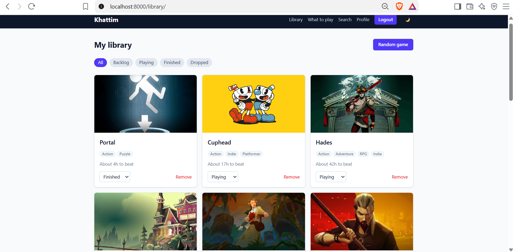
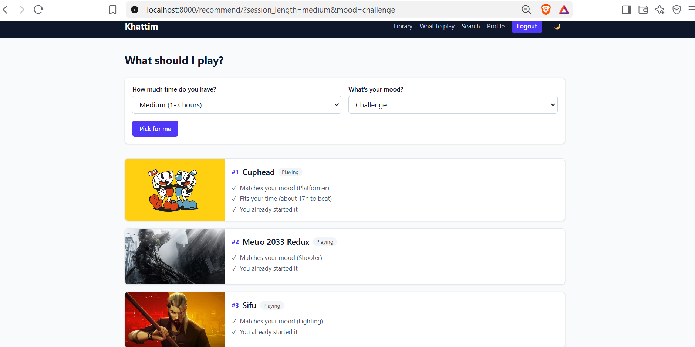
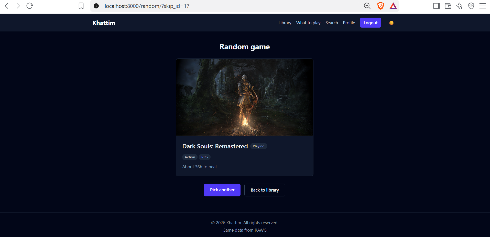

# Khattim 

A web app that helps you decide what to play from the games you already own,
instead of letting your backlog pile up. Tell it how much time you have and
what mood you are in, and it ranks the games in your own library.

## Features

- Accounts: register, login, logout, profile with avatar and display name, password change
- Search games through the [RAWG](https://rawg.io) API and add them to your personal library
- Track each game as Backlog, Playing, Finished or Dropped (saved as soon as you change it)
- Filter your library by status
- "What should I play?": ranked picks with the reasons behind each one
- Random game picker (from Backlog and Playing, never repeats the previous pick)
- Responsive layout with a light and dark mode toggle, remembered with a cookie

## Tech stack

- Python and Django, SQLite
- Tailwind CSS v4.3 (the compiled stylesheet is included in the repository)
- RAWG API for game data (name, image, genres, playtime)

## How recommendations work

Only games in your library with the status Backlog or Playing are considered.
Each game gets a score:

| Rule | Points |
|---|---|
| Each genre that matches your mood | +3 |
| Game length fits the time you picked | +2 |
| You already started it (Playing) | +2 |

Games with a score of zero are left out. The top three are shown, and ties go
to the game that has been in your library longest. Each pick lists why it was
chosen. The rules live in `games/views.py` (`TIME_RULES`, `MOOD_GENRES` and
`recommend_games`) and are easy to tweak.

| Time you picked | Game length that fits |
|---|---|
| Short | up to 10 hours |
| Medium | 11 to 30 hours |
| Long | 31 hours or more |

| Mood | Genres |
|---|---|
| Relax | Casual, Puzzle, Simulation, Family |
| Story | Adventure, RPG |
| Challenge | Platformer, Strategy, Fighting, Shooter |
| Action | Action, Shooter, Arcade, Racing |

A game with an unknown playtime (0) gets no points for time, and loses none.

## Playtime data

Playtimes come from RAWG and are approximate. They are only a small part of
the recommendation score, so a wrong value shifts the ranking slightly and
never excludes a game. 

Some values were adjusted by me based on my own experience with the games.


## Screenshots






## Getting started

Requirements: Python 3.14 or newer.

```powershell
git clone https://github.com/Shahad-Alneghemishi/khattim.git
cd khattim

python -m venv venv
venv\Scripts\Activate.ps1        # macOS/Linux: source venv/bin/activate
pip install -r requirements.txt

cd khattim                       # the folder that contains manage.py
copy .env.example .env           # macOS/Linux: cp .env.example .env
```

Fill in `.env`:

```
DJANGO_SECRET_KEY=generate-one-below
DJANGO_DEBUG=1
RAWG_API_KEY=your-key-from-rawg.io/apidocs
```

The RAWG key is only needed for searching and adding new games.

Generate a secret key:

```powershell
python -c "from django.core.management.utils import get_random_secret_key; print(get_random_secret_key())"
```

Then:

```powershell
python manage.py migrate
python manage.py createsuperuser
python manage.py runserver
```

Open http://127.0.0.1:8000.

## Project structure

```
khattim/                 repository root
├── khattim/             Django project (manage.py lives here)
│   ├── games/           app: models, views, forms, templates, static files
│   ├── khattim/         settings and root URLs
│   ├── manage.py
│   └── package.json     Tailwind CLI scripts
├── requirements.txt
└── README.md
```

## Design notes

- **Library first.** Games are fetched from RAWG once and stored locally.
  Viewing the library, recommendations and the random picker never call RAWG,
  so they keep working if the API is down. Only search and adding a new game
  need it, and failures show a message instead of an error page.
- **API usage.** Search results are cached for an hour, and the server fetches
  game details itself from the game ID, so the browser never supplies game data.
- **Per-user data.** Every library action checks that the entry belongs to the
  logged-in user.
- **Safe requests.** Actions that change data accept POST only, and form
  values such as status and mood are validated on the server.
- **Secrets.** Keys live in `.env`, which is not committed.
- **Minimal JavaScript.** Dark mode is a Django view plus a cookie. The only
  script is the status dropdown that submits itself on change.

## Future work

- Arabic translation and right-to-left layout
- Search my own database first, with a "search RAWG" button for more results
- Statistics page: completion rate, games per status, backlog size
- Wishlist
- Import a library from Steam
- Per-game notes and a personal rating
- Automated tests for the recommendation rules
- Deployment with a public demo link

## Credits

Game data and images from [RAWG](https://rawg.io).